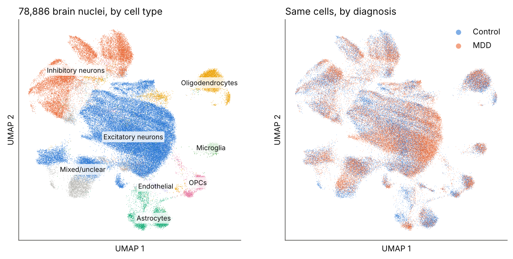
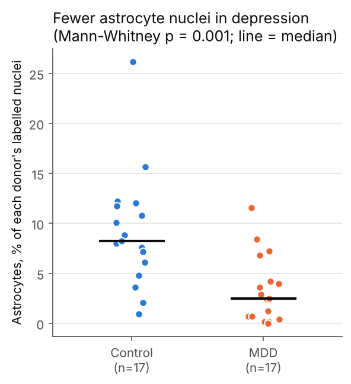
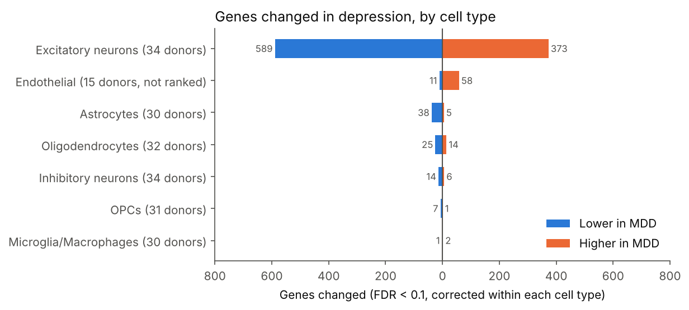
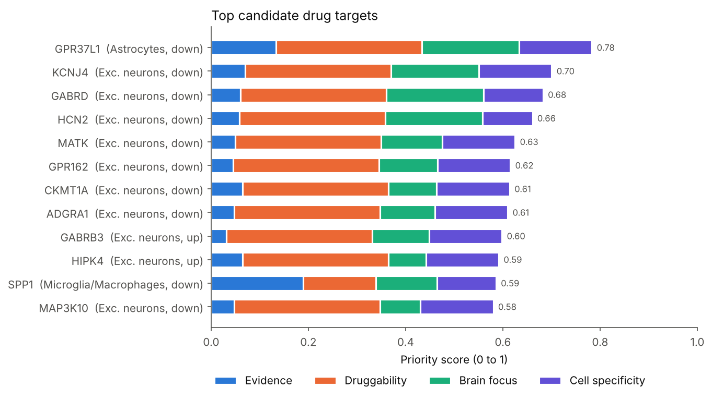

# Finding new drug targets for depression, one brain cell type at a time

Almost every antidepressant on the market works on the same idea: boost serotonin or
related neurotransmitters in neurons. About a third of patients don't respond, and the
drugs take weeks to work. This project asks a different question:

> **In the brains of people with depression, which non-obvious cell types change, and
> which of the changed genes could realistically be hit with a drug?**

I reanalysed a public single-nucleus RNA-seq dataset from the
Douglas-Bell Canada Brain Bank (McGill), then ran the
changed genes through a simple, transparent target-prioritisation pipeline of the kind
used in early-stage drug discovery. This is a reanalysis of published data, not new data.
Its contribution is that an independent, open pipeline using the male data alone
converges on GPR37L1, a gene the original group has since flagged with chromatin and
spatial data [5].

**What is here:** `src/` holds the six-step pipeline, `results/tables/` the differential
expression and target-scoring output, `results/figures/` the four figures below,
`docs/delivery_design.md` a proposed delivery route for the top target, and
`docs/audit.md` an independent review of this analysis and its weaknesses. The raw data
is not included; [Reproduce](#reproduce) says how to download it.

## Key findings

1. **Fewer astrocyte nuclei in depression.** Astrocytes make up a median 8.2% of
   labelled nuclei in control brains but only 2.5% in MDD brains (17 vs. 17 donors,
   Mann-Whitney p = 0.001; including the `Mixed/unclear` cluster in the denominator
   gives 7.8% vs. 2.3%, p = 0.001). Only the direction should be trusted, not the
   size: a 3-fold loss of cortical astrocytes is not biologically plausible, and the
   original authors cautioned that their dissections were not consistent enough to
   estimate proportions at all [1]. A later analysis that reused 33 of these men and
   added 38 women [4] did test proportions, with more covariates, and also
   found astrocytes significantly reduced in depression (FDR 3.5e-4) — but by a far
   smaller margin, so treat the size of the gap here as largely technical.
2. **Excitatory neurons show the most gene changes** (962 genes at FDR < 0.1, corrected
   within each cell type). Nagy et al. [1] likewise found deep-layer excitatory neurons
   among the most affected, but their other headline cell type, OPCs, shows only 8
   changed genes here. The counts are not comparable: they tested 26 fine-grained
   clusters with a single-cell mixed model (donor as a random effect, adjusted for
   sequencing depth) and reported 96 differentially expressed genes in total, where
   this pipeline tests 7 broad cell types by pseudobulk and finds 1,144 (1,075 of them
   in the six cell types with enough donors to be ranked).
3. **The top-ranked target is GPR37L1, an astrocyte receptor.** It is lower in MDD
   astrocytes (log2 fold change -1.39, FDR 0.049) and OPCs, belongs to the GPCR family
   (the most successfully drugged protein family), and is expressed about 300 times more
   in brain than in the median non-brain tissue (GTEx v8: 42.6 vs 0.14 TPM), which
   suggests fewer side effects elsewhere.
   The drop holds when any one donor is left out, is only slightly reduced when
   astrocyte numbers are accounted for, and is the strongest astrocyte change in the
   authors' own reanalysis of these men. It does **not** replicate in women
   (see [Robustness and replication](#robustness-and-replication)). A 2026 preprint from
   the same group [5] independently reports GPR37L1 lower in MDD
   astrocytes, with reduced chromatin accessibility at the gene and reduced
   prosaposin (PSAP) to GPR37L1 signalling from neurons, also driven by men.

| | |
|---|---|
|  |  |
|  |  |

Full tables: [`target_shortlist.csv`](results/tables/target_shortlist.csv),
[`all_hits_scored.csv`](results/tables/all_hits_scored.csv),
[`de_mdd_vs_control_by_celltype.csv`](results/tables/de_mdd_vs_control_by_celltype.csv).

From target to therapy: see [`docs/delivery_design.md`](docs/delivery_design.md) for a
proposed way to get a GPR37L1-targeting drug into the brain.

## Data

**GSE144136** (Nagy et al. 2020 [1]):

- 78,886 nuclei from the dorsolateral prefrontal cortex (BA9)
- 17 men with major depressive disorder who died by suicide, 17 matched male controls
- Cell-type labels are the authors' own

Supporting data: [HGNC](https://www.genenames.org/) gene families (druggability) and
[GTEx v8](https://gtexportal.org/) median expression by tissue (brain focus). Both are
downloaded automatically by `03_rank_targets.py`.

## Method

| Step | Script | What it does |
|---|---|---|
| 1 | `src/01_load_and_qc.py` | Loads the count matrix, parses donor, diagnosis and batch from each cell name, builds a UMAP cell map. No extra QC filtering: it uses the authors' filtered matrix and their cell labels as published |
| 2 | `src/02_pseudobulk_de.py` | Sums counts per donor and cell type ("pseudobulk") and tests MDD vs. control with DESeq2, adjusting for batch |
| 3 | `src/03_rank_targets.py` | Scores every changed gene on evidence, druggability, brain focus and cell-type specificity |
| 4 | `src/04_figures.py` | Makes the figures above |
| 5 | `src/05_weight_sensitivity.py` | Checks whether the ranking holds up when the score weights change |
| 6 | `src/06_gpr37l1_robustness.py` | Leave-one-donor-out, astrocyte-share and nucleus-quality checks on the GPR37L1 result |

**Why pseudobulk?** Cells from the same person are not independent. Testing tens of
thousands of single cells as if they were makes almost everything look significant.
Summing per donor and comparing donors is the recommended approach [2]. A cell type is tested only in donors with at
least 10 nuclei of it. For astrocytes that leaves 30 of 34 donors (14 MDD, 16 controls);
3 of the 4 dropped are MDD men with almost no astrocyte nuclei, so the GPR37L1 result
does not rely on the most extreme samples. Library-prep batches are balanced between
groups (`02_pseudobulk_de.py` prints the table).

**Priority score** = 0.35 × evidence + 0.30 × druggability + 0.20 × brain focus
+ 0.15 × cell specificity, each scaled 0 to 1. The weights are a judgement call and are
easy to change at the top of `03_rank_targets.py`.

**Does the ranking depend on those weights?** `05_weight_sensitivity.py` re-ranks the
candidates with 2,000 random weight combinations. GPR37L1 ranks first in 97% of them
and in the top 5 in all of them ([`weight_sensitivity.csv`](results/tables/weight_sensitivity.csv)).
This should not be over-read. Druggability, brain focus and specificity reach their
maximum of 1.0 for many genes, while evidence never exceeds 0.54 across the eligible hits
(GPR37L1: 0.38). The ranking is therefore mostly a ranking of protein families, with
evidence as a tie-breaker. GPR37L1 is the only hit that scores 1.0 on druggability,
brain focus and specificity at once (only 8 hits are GPCRs), so it comes first under
almost any weighting. The weight test confirms this but does not independently
validate it. Rescaling the evidence score so it spans the full 0-1 range across the
eligible hits (either min-max, or rank of p-value within cell type) does not change the
winner: GPR37L1 still ranks first either way, and the rest of the top 5 shuffles.

The scoring is in the spirit of established target-assessment frameworks: AstraZeneca's
"5R" framework [6] and the druggable genome [7, 8]. Druggability here is a simple keyword
match on HGNC gene-family names, not a lookup in a tractability database such as
Open Targets.

## Robustness and replication

| Check | GPR37L1 in MDD astrocytes | p-value | FDR |
|---|---|---|---|
| Main model (`~ batch + condition`) | log2FC -1.39 (2.6x lower) | 8e-5 | 0.049 |
| Leave one donor out, 30 refits | -1.16 to -1.55 | < 5e-4 in all 30 | < 0.05 in 7, < 0.1 in 21 |
| Adding each donor's % astrocyte nuclei | -1.29 | 0.002 | 0.055 |
| Adding % astrocyte nuclei and median genes per astrocyte nucleus (nucleus quality) | -1.29 | 0.0015 | 0.048 |
| Maitra et al. [4], same men reprocessed (edgeR, adjusted for age, pH, PMI, batch) | -1.86, #1 of 90 astrocyte genes | 3e-10 | 8e-6 |
| Maitra et al. [4], women (20 MDD, 18 controls) | -0.50 | 0.09 | 0.97 |

The size of the effect is stable; the FDR in this pipeline sits near the 0.05 line. It
is essentially unchanged when Benjamini-Hochberg correction is applied across all
66,942 tests in all cell types at once (astrocytes 0.047, OPCs 0.026), though the
number of significant genes then falls from 1,144 to 448. The
result is male-specific so far, in line with the finding [4] that depression
implicates different cell types in men (astrocytes, neurons) and women (microglia).
Tables: [`gpr37l1_leave_one_donor_out.csv`](results/tables/gpr37l1_leave_one_donor_out.csv),
[`gpr37l1_astro_pct_covariate.csv`](results/tables/gpr37l1_astro_pct_covariate.csv),
[`gpr37l1_maitra2023_lookup.csv`](results/tables/gpr37l1_maitra2023_lookup.csv)
(values from [4], Supplementary Data 5–7).

**Related work.** Mitsuhashi et al. [5] combined snRNA-seq, snATAC-seq and spatial
transcriptomics, and find GPR37L1 lower in protoplasmic
astrocytes in MDD (adj. p 0.0095), with reduced chromatin accessibility, lower expression in
cortical layers 5–6, and reduced PSAP–GPR37L1 signalling from deep-layer neurons to
astrocytes. The effect is male-driven (males adj. p 0.0064, females 1.0). It uses the same
McGill cohorts, so it is corroboration with new data types, not independent replication.
It also means GPR37L1 is not a new finding of this project.

## Limitations

- **Men only, one brain region, small n.** 34 donors is large for postmortem brain
  but small for genetics. The top target did not replicate in a female cohort.
- **Few covariates.** The model adjusts only for batch, not for age, pH or post-mortem
  interval. The authors' reanalysis, which does adjust for these, finds GPR37L1 even
  more strongly.
- **Suicide as well as depression.** All cases died by suicide, so changes may reflect
  suicide, depression, medication, or death circumstances.
- **Astrocyte sample quality differs between groups.** The astrocyte cluster partly
  splits by diagnosis on the UMAP, and the top astrocyte hits by p-value are neuronal
  genes (AP1S1, TUBB4A, STMN3, TUBB, DYNLL2, all lower in MDD). This points to
  technical differences in astrocyte nuclei between groups. Core astrocyte markers
  (GFAP, AQP4, SLC1A2/3, ALDH1L1, SOX9) are unchanged, median genes detected per
  astrocyte nucleus is similar in both groups (443 vs 429), and GPR37L1 stays lower when
  that is added as a covariate (log2FC -1.29, FDR 0.048).
- **Ambient RNA.** Fewer astrocytes in MDD samples means less stray astrocyte RNA in
  every cell type, so astrocyte genes look "down" even in neurons. The specificity
  score flags these (90 of the 1,075 ranked hits) and the shortlist excludes them.
- **Druggability is a family-level proxy.** Belonging to a druggable family doesn't
  mean a drug exists or that changing the gene would help.
- **Fewer astrocyte nuclei is not proof of fewer astrocytes.** Nagy et al. (2020) wrote
  that consistency across dissections "was not sufficient for estimating cell type
  proportions". Histology would be needed to confirm a real loss of astrocytes.
- **GPR37L1 is part of a wider astrocyte change.** Other astrocyte genes (e.g. GJA1,
  GLUL, APOE) are also lower in MDD in the authors' reanalysis, so GPR37L1 may mark
  altered astrocytes rather than act alone.

## What would resolve each limitation

Each open question above has a study that could answer it. Roughly in order of how
cheaply it could be done:

| Question left open | Study that would answer it |
|---|---|
| Is the GPR37L1 drop about depression, or about suicide? | Compare three groups in the same brain bank: MDD who died by suicide, MDD who died of other causes, and controls. The Douglas-Bell bank holds all three. If the drop tracks diagnosis rather than manner of death, the suicide confound is resolved. |
| Could antidepressants explain it? | Stratify the same donors by toxicology at death (medicated vs not). Brain banks record this; the processed GEO matrix does not carry it. |
| Are there really fewer astrocytes, or just fewer astrocyte nuclei recovered? | Count astrocytes directly in tissue sections by immunohistochemistry for GFAP and ALDH1L1 with stereology. This is the one check that settles Figure 2, and it needs no sequencing. |
| Is GPR37L1 genuinely lower inside astrocytes, or is it stray RNA? | RNAscope or single-molecule in situ hybridisation on sections: count GPR37L1 transcripts inside GFAP-positive cells. Spatial data cannot be contaminated the way droplet data can. |
| Is the result male-specific, or just underpowered in women? | Re-run this exact pipeline on the female cohort (GSE213982) and test the sex-by-diagnosis interaction directly, rather than comparing two separate analyses. |
| Is the borderline FDR real? | Meta-analyse across independent MDD cortex cohorts, or measure GPR37L1 by qPCR in sorted astrocytes from a new set of donors. |
| Is low GPR37L1 a cause of depression or a consequence of unwell astrocytes? | Knock down or overexpress GPR37L1 in human iPSC-derived astrocytes and look at astrocyte function; then an astrocyte-specific conditional knockout in mice with chronic stress and behavioural testing. |
| Would activating it help? | Settle the ligand question first with a deorphanisation screen, since prosaptide's action at GPR37L1 is disputed, then test a validated agonist in the models above. |

The first four use tissue the brain bank already holds and need no new cohort, so they
are the realistic next steps for a student project. The last two are a thesis.

## References

1. Nagy C, Maitra M, Tanti A, et al. Single-nucleus transcriptomics of the prefrontal
   cortex in major depressive disorder implicates oligodendrocyte precursor cells and
   excitatory neurons. *Nature Neuroscience* 23, 771–781 (2020).
   [doi:10.1038/s41593-020-0621-y](https://doi.org/10.1038/s41593-020-0621-y)
2. Squair JW, Gautier M, Kathe C, Anderson MA, James ND, Hutson TH, Hudelle R,
   Qaiser T, Matson KJE, Barraud Q, Levine AJ, La Manno G, Skinnider MA, Courtine G.
   Confronting false discoveries in single-cell differential expression.
   *Nature Communications* 12, 5692 (2021).
   [doi:10.1038/s41467-021-25960-2](https://doi.org/10.1038/s41467-021-25960-2)
3. Wolf FA, Angerer P, Theis FJ. SCANPY: large-scale single-cell gene expression data
   analysis. *Genome Biology* 19, 15 (2018).
   [doi:10.1186/s13059-017-1382-1](https://doi.org/10.1186/s13059-017-1382-1)
4. Maitra M, Mitsuhashi H, Rahimian R, Chawla A, Yang J, Fiori LM, Davoli MA,
   Perlman K, Aouabed Z, Mash DC, Suderman M, Mechawar N, Turecki G, Nagy C. Cell type
   specific transcriptomic differences in depression show similar patterns between males
   and females but implicate distinct cell types and genes. *Nature Communications* 14,
   2912 (2023).
   [doi:10.1038/s41467-023-38530-5](https://doi.org/10.1038/s41467-023-38530-5)
5. Mitsuhashi H, et al. Multi-omics characterization of astrocyte subtypes reveals
   spatially coordinated astrocyte downregulation in depression. *bioRxiv*, July 2026.
   [preprint](https://sciety.org/articles/activity/10.64898/2026.07.02.735636)
6. Cook D, Brown D, Alexander R, et al. Lessons learned from the fate of AstraZeneca's
   drug pipeline: a five-dimensional framework. *Nature Reviews Drug Discovery* 13,
   419–431 (2014). [doi:10.1038/nrd4309](https://doi.org/10.1038/nrd4309)
7. Hopkins AL, Groom CR. The druggable genome. *Nature Reviews Drug Discovery* 1,
   727–730 (2002). [doi:10.1038/nrd892](https://doi.org/10.1038/nrd892)
8. Finan C, Gaulton A, Kruger FA, et al. The druggable genome and support for target
   identification and validation in drug development. *Science Translational Medicine*
   9, eaag1166 (2017).
   [doi:10.1126/scitranslmed.aag1166](https://doi.org/10.1126/scitranslmed.aag1166)

## Reproduce

```bash
pip install -r requirements.txt
# Download all supplementary files from
# https://www.ncbi.nlm.nih.gov/geo/query/acc.cgi?acc=GSE144136 into data/raw/
./run_all.sh
```

Steps 1-5 need about 8 GB of RAM and take about 10 minutes on a laptop. Step 6 refits
the astrocyte model 30 times and takes roughly 45 minutes more.

Analysis code is in Python with scanpy [3] and PyDESeq2; exact versions are pinned in
`requirements.txt`.

## About

**Giuliana Vizino-Zambito** — B.Sc. Anatomy & Cell Biology, McGill University.
Co-author on *Kelserra: an algae-inspired bioadhesive for use in minimally invasive
surgeries* (Fraser et al., *Biotechnology Design* 4, e8, 2026,
[doi:10.1017/S2977905726100195](https://doi.org/10.1017/S2977905726100195)), where I
co-led the validation subteam, running the mechanical testing, microscopy and
degradation studies.

My interests are translational: how a finding in human tissue becomes a therapy. That
spans target discovery from patient data, biomaterials and drug delivery, and the
design and validation work that joins the two. This project runs that path end to end,
from single-nucleus transcriptomics of the depressed brain to a candidate receptor and
a proposed way to reach it.

Built in Python, with Claude as a coding assistant. Released under the MIT licence; see
`CITATION.cff` to cite this repository. The underlying data belongs to its original
authors [1].

Questions, corrections and reuse are welcome: open an issue.
